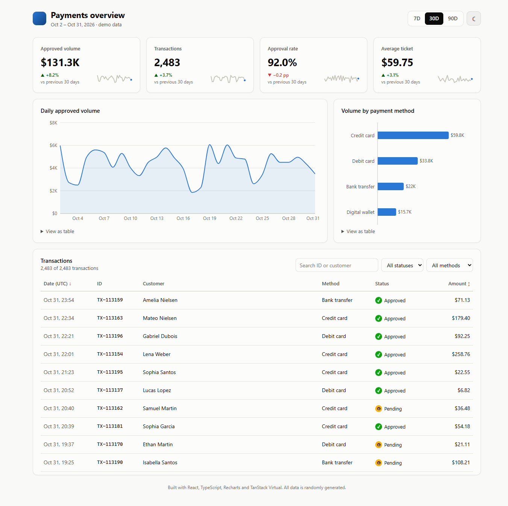
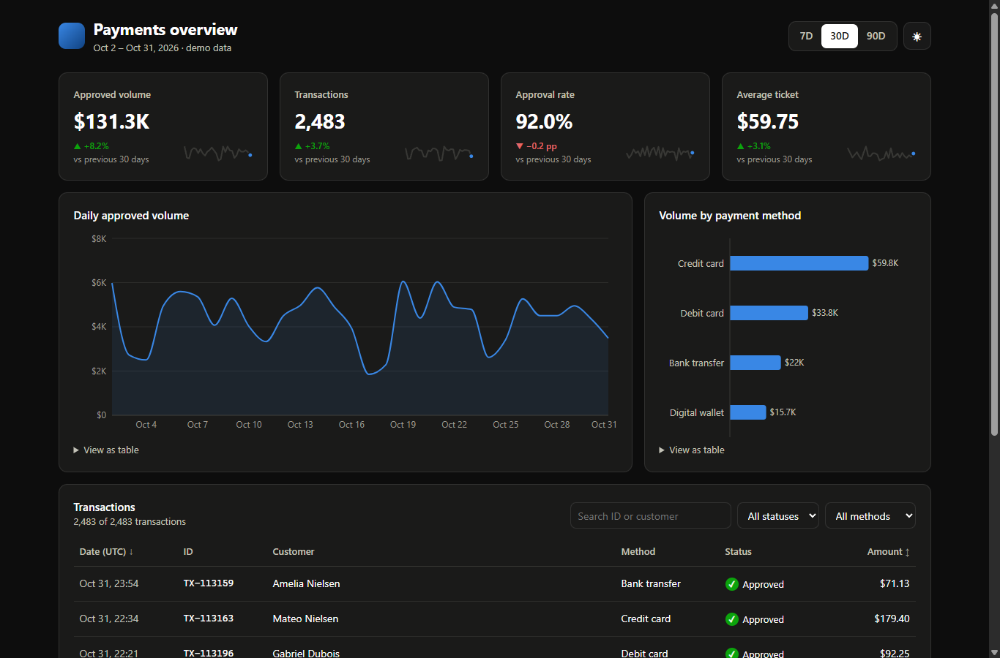

# Payments Dashboard

A payments analytics dashboard built with **React 19, TypeScript, Recharts and TanStack Virtual**.
It shows KPIs, trends and a searchable table of 14,000+ transactions, with light and dark themes and a responsive layout.

**Live demo: https://brunoicosta.github.io/fintech-dashboard/**

All data is generated in the browser with a seeded random generator, so the demo always shows the same numbers.





## Features

- **KPI tiles**: approved volume, transaction count, approval rate and average ticket, each compared with the previous period and with a sparkline trend.
- **Date ranges**: 7, 30 and 90 days. Every number, chart and table updates together.
- **Charts**: daily approved volume (area chart with tooltip) and volume by payment method (bar chart).
- **Transactions table**: search by ID or customer, filter by status and method, sort by date or amount.
- **Light and dark themes**: follows the OS setting by default and remembers the user's choice.
- **Responsive**: works from phone to desktop. On small screens the table scrolls horizontally inside its card.

## Technical highlights

- **Virtualized table.** Only the visible rows (plus a small overscan) are rendered, so filtering and scrolling 14k rows stays smooth. Built with `@tanstack/react-virtual`.
- **Responsive search.** `useDeferredValue` keeps typing instant while the filter runs at a lower priority.
- **Single-pass aggregation.** `summarize()` buckets the data by day once and derives the KPIs, the daily series, the previous period and the method mix from that pass.
- **Money as integer cents.** Amounts are never stored as floating-point dollars, which avoids rounding errors.
- **Correct dates.** Days are bucketed and displayed in UTC, so charts don't shift by a day for users in other time zones.
- **Accessibility.** Status is shown with an icon and a label, never color alone. Charts have a "View as table" alternative. Sortable headers expose `aria-sort`, and the table uses ARIA table roles. Focus states are visible.
- **Design tokens.** Colors are CSS custom properties with separate light and dark values. The chart colors come from a palette checked for color-vision deficiency.

## Project structure

```
src/
  data/         types and the seeded transaction generator
  lib/          formatting and metrics (pure functions, unit tested)
  hooks/        useTheme
  components/   StatTile, Sparkline, VolumeChart, MethodChart, TransactionsTable, ...
```

## Running locally

Requires Node.js 20 or newer.

```bash
npm install
npm run dev      # start the dev server
npm test         # run the unit and component tests
npm run build    # type-check and build for production
```

## Tests

Written with Vitest and Testing Library:

- KPI math, including the edge cases (empty periods, pending and refunded transactions left out of the approval rate)
- Date windows across month boundaries
- Filtering and sorting
- Formatting (currency, compact numbers, percentage-point deltas)
- Table behavior: filter counts, the empty state and sort toggling
